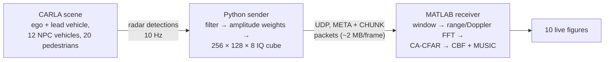

# FMCW MIMO Radar DSP Framework Using CARLA Simulation & MATLAB

A live pipeline that treats a [CARLA](https://carla.org) traffic scene as if it were seen by a 77 GHz automotive FMCW MIMO radar.

- A **Python** script runs the CARLA scene and turns each radar tick into a synthetic IQ radar data cube.
- A **MATLAB** script receives the cube over UDP and runs the full processing chain live: range-Doppler processing, CA-CFAR detection, FFT beamforming and MUSIC angle estimation, shown in ten figure windows.



## Repository layout

| Path | What it is |
|---|---|
| `python/carla_radar_sender.py` | CARLA scene, detection filter, data-cube synthesis, UDP sender |
| `python/carla_radar_sender_v2.py` | Same, with correct radial velocities (see [Versions of the pipeline](#versions-of-the-pipeline)) |
| `python/carla_radar_sender_v3.py` | v2 plus TDM-MIMO and an elevation transmitter |
| `python/cut_in_demo.py` | Scripted cut-in scene for demonstrations and screen recordings |
| `python/test_sender.py` | Offline checks for the sender (no CARLA needed) |
| `matlab/carla_radar_full_live.m` | UDP receiver and the full radar signal processing chain |
| `matlab/carla_radar_full_live_v2.m` | Same chain, run on every frame; matches sender v2 |
| `matlab/carla_radar_full_live_v3.m` | v2 plus TDM compensation and elevation MUSIC; matches sender v3 |
| `VERSIONS.md` | One-page overview of v1, v2 and v3 |
| `CHANGELOG.md` | What changed since the initial version |

## Requirements

- **CARLA 0.9.x simulator**, plus the `carla` Python package of the **same version** as the server.
- **Python 3.8+** with `numpy` (`pip install -r requirements.txt`).
- **MATLAB R2020b or newer** for `udpport`. No toolboxes are needed.

## Quick start

1. Start the CARLA simulator in an 800 × 600 window in the top-left corner. The server must listen on `localhost:2000`:
   ```powershell
   .\CarlaUE4.exe -quality-level=Low -windowed -ResX=800 -ResY=600 -WinX=0 -WinY=0
   ```
2. Start the sender:
   ```bash
   cd python
   python carla_radar_sender.py
   ```
3. In MATLAB, run `matlab/carla_radar_full_live.m`.

The ten figure windows arrange themselves around the CARLA window: Fig 1/4/3 and Fig 2/5/7 to its right, Fig 8/6/9/10 along the bottom. If your CARLA window has a different size, change `CARLA_AREA` near the top of the MATLAB script.

### Running smoothly on a laptop

- **Synchronous mode (Python).** The sender runs CARLA in fixed 50 ms steps, paced to real time (`USE_SYNC_MODE`, `SYNC_FIXED_DELTA`). The original world settings are restored when you stop the sender with `Ctrl+C`.
- **Display rate (MATLAB).** Redrawing ten windows is the slowest part and shares the GPU with CARLA. MATLAB shows at most `DISPLAY_FPS` frames per second (default 2) and stays idle in between. On a fast PC, set it to 10.
- **Laptop.** Plug in the charger and choose the *Best performance* power mode in Windows. Close other heavy programs. If CARLA still stutters, lower `NUM_WALKERS` and `NUM_NPC_VEHICLES` in the sender.

- **To stop MATLAB:** close any figure window.
- **To stop the sender:** press `Ctrl+C` in its terminal.
- **Recorded detections:** the sender also writes every raw detection to `radar_log.csv`.

### Cut-in demo

`python/cut_in_demo.py` plays a short, repeatable scene instead of random traffic. It uses the same radar, cube and UDP stream, so the MATLAB script runs unchanged. Start MATLAB first, then:

```bash
cd python
python cut_in_demo.py
```

The scene runs in Town04, on a long two-lane road with no other traffic, and takes about 30 s:

1. **Free road:** nothing in front of the ego vehicle. The radar shows only the roadside (static objects at −10 m/s relative velocity).
2. **Overtake:** a second car passes in the left lane, outside the radar field of view.
3. **Cut-in:** it changes into the ego lane about 8 m ahead and appears from the side of the field of view.
4. **Braking:** it slows down, and the ego brakes behind it (a closing target, negative relative velocity).
5. **Pull away:** it speeds up again (an opening target, positive relative velocity).

The console prints each phase with the simulation time, which matches `t=` in the MATLAB frame log. Speeds, distances and durations are set at the top of the script. `--side right` makes the car come from the right, and `--seed N` picks another stretch of road.

Afterwards, switch CARLA back to the map of the normal scene with `python cut_in_demo.py --load-map Town10HD_Opt` (or restart CARLA).

### Offline test

To check the sender without CARLA:

```bash
cd python
python test_sender.py
```

This compares the vectorised cube with a plain reference loop, checks the filters and weights, and runs a UDP loopback round trip plus a threading test.

## Versions of the pipeline

Each Python sender has a matching MATLAB receiver. Run them as a pair, the same way as in the quick start.

| Pair | Sender / receiver | What it adds |
|---|---|---|
| v1 | `carla_radar_sender.py` / `carla_radar_full_live.m` | The base pipeline described below |
| v2 | `carla_radar_sender_v2.py` / `carla_radar_full_live_v2.m` | Correct radial velocities; every frame is processed |
| v3 | `carla_radar_sender_v3.py` / `carla_radar_full_live_v3.m` | v2 plus TDM-MIMO and elevation |

**v2: correct velocities.** CARLA's radar computes its own velocity from the distance it moved since its last scan, divided by one simulation step. With a 0.1 s sensor tick and 0.05 s steps, the ego velocity is counted twice: in v1, static objects appear at −2 × ego speed. v2 lets the radar scan on every step and sends every second scan, so MATLAB still gets 10 frames per second.

**v2: every frame processed.** The MATLAB receiver runs the whole chain on every frame and only limits how often the ten windows are redrawn (`DISPLAY_FPS`). The log shows the share of frames processed; on a laptop that also runs CARLA it is 100 %, at about 20 ms per frame.

**v3: TDM.** The transmitters take turns within every chirp loop, so each one is revisited every *N*<sub>TX</sub> × *T*<sub>c</sub>. The maximum velocity becomes λ / (4 *N*<sub>TX</sub> *T*<sub>c</sub>). The receiver removes the motion-induced phase between the transmitters before angle estimation (`TDM_COMPENSATE`).

**v3: elevation.** With `ENABLE_ELEVATION_TX = True` (Python) and `true` (MATLAB), a third transmitter sits λ/2 above the array, between TX0 and TX1:

```
height d   .   .   T2  .   .   .   .   .        TX2 row: virtual elements at x = 2d..5d
height 0   T0  .   .   .   T1  .   .   .        TX0, TX1: 8-element azimuth ULA, x = 0..7d
```

The 8-element azimuth array stays the same; the phase between the two rows gives the elevation angle (Fig 9). Both switches must have the same value.

| | v1 / v2 | v3, 2 TX | v3, 3 TX (default) |
|---|---|---|---|
| Transmitters / virtual channels | 2 / 8 | 2 / 8 | 3 / 12 |
| Chirp timing | all channels on every chirp | TDM | TDM |
| Max. velocity / velocity resolution | 97.3 / 1.52 m/s | 48.7 / 0.76 m/s | 32.5 / 0.51 m/s |
| Elevation | no | no | yes |

In CARLA, v3 estimated elevation within about 0.3° of CARLA's altitude angle and processed 92–97 % of the frames on a laptop, at about 30 ms per frame. Occasional long redraws while CARLA uses the GPU cause the missing frames; a lower `DISPLAY_FPS` reduces them.

## Radar configuration

Values for v1 and v2; see the table above for v3.

| Parameter | Value |
|---|---|
| Carrier frequency / bandwidth / chirp duration | 77 GHz / 150 MHz / 10 µs |
| Samples per chirp / chirps per frame | 256 / 128 |
| Array | 2 TX × 4 RX → 8-element virtual ULA, d = λ/2 |
| Range resolution / velocity resolution / max velocity | 1.0 m / 1.52 m/s / 97.3 m/s |
| CARLA radar | 60 m range, 30° × 10° FOV, 1500 points/s, 0.1 s tick |
| Detections used for the cube | 4–60 m, 0.5 < \|v\| ≤ 40 m/s, forward-facing |
| Injected noise | complex AWGN at 15 dB SNR (MATLAB), plus σ = 0.05 (Python) |
| CA-CFAR | 2 guard / 4 training cells per side (13 × 13 window, 144 training cells), P_fa = 10⁻⁴ |

The parameters are set at the top of each script. Values that appear in both scripts (waveform, array size, port) must stay the same in both.

## UDP protocol

All integers are little-endian.

| Packet | Content |
|---|---|
| META (12 bytes) | `uint32 0xCAFEBEEF`, `uint32 num_chunks`, `uint32 total_bytes` |
| CHUNK (16 + n bytes) | `uint32 0xDEADF00D`, `uint32 frame_id`, `uint32 chunk_index`, `uint32 n`, payload |

The reassembled frame contains, in this order:

1. A 24-byte header: `numVirtual`, `numADC`, `numChirps`, `timestamp` (double), `numDet`.
2. The raw CARLA detections, as `float32 [numDet × 4]` with columns velocity, azimuth, altitude, depth.
3. The cube, as `complex64 [8 × 256 × 128]` in C order.

The receiver handles bad or late packets as follows:

- It locks onto one `frame_id` and discards stale, foreign and duplicate chunks.
- If two or more frames are waiting in the queue, it drops them and resynchronises on the next frame.
- The *Flushed pkts* value in the info window counts everything it discarded for the current frame. `0` means it is keeping up in real time.

## Known limitations

- **Synthetic signal model.** The cube is built from CARLA's ray-cast detections using ideal complex exponentials. It has no oscillator phase noise, no multipath and no physical radar cross-section; reflectivity is a heuristic weight (0.1 for targets slower than 2 m/s) times an R⁻⁴ power factor. The angle results therefore depend on this signal and array model.
- **TDM and elevation only in v3.** In v1 and v2, all eight virtual channels are synthesised on every chirp, as in an ideal MIMO radar, and the cube carries azimuth phase only. Their *Fig 9* is a placeholder and does **not** measure elevation. v3 adds both (see [Versions of the pipeline](#versions-of-the-pipeline)). Its elevation uses two rows λ/2 apart, so it estimates one target per range-Doppler cell well but cannot separate two targets in the same cell by elevation.
- **Velocities in v1.** v1 counts the ego velocity twice in the radial velocities (see v2 above). Range and angles are not affected.
- **Static-return filter.** All versions drop detections with |radial velocity| ≤ 0.5 m/s. This removes static objects only while the ego vehicle stands still. While driving, static objects pass the filter and a vehicle moving at the ego speed is removed. Filtering on ground speed (radial velocity plus the ego motion) would fix this.

## Versions

- `v0.1.0`: the initial version.
- `v1.0.0`: angle-estimation fix, Python and MATLAB brought in line with each other, faster receiver and sender, documentation, cut-in demo, and the v2 and v3 pipelines.

Every change is a separate commit; [CHANGELOG.md](CHANGELOG.md) summarises them.

## License

[MIT](LICENSE)
