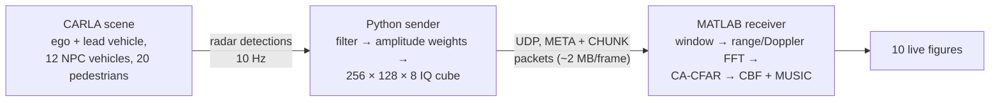

# FMCW MIMO Radar DSP Framework Using CARLA Simulation & MATLAB

A live pipeline that treats a [CARLA](https://carla.org) traffic scene as if it were seen by a 77 GHz automotive FMCW MIMO radar.

- A **Python** script runs the CARLA scene and turns each radar tick into a synthetic IQ radar data cube.
- A **MATLAB** script receives the cube over UDP and runs the full processing chain live: range-Doppler processing, CA-CFAR detection, FFT beamforming and MUSIC angle estimation, shown in ten figure windows.



## Repository layout

| Path | What it is |
|---|---|
| `python/carla_radar_sender.py` | CARLA scene, detection filter, data-cube synthesis, UDP sender |
| `python/test_sender.py` | Offline checks for the sender (no CARLA needed) |
| `matlab/carla_radar_full_live.m` | UDP receiver and the full radar signal processing chain |
| `CHANGELOG.md` | What changed since the initial version |

## Requirements

- **CARLA 0.9.x simulator**, plus the `carla` Python package of the **same version** as the server.
- **Python 3.8+** with `numpy` (`pip install -r requirements.txt`).
- **MATLAB R2020b or newer** for `udpport`. No toolboxes are needed.

## Quick start

1. Start the CARLA simulator in an 800 × 600 window in the top-left corner. The server must listen on `localhost:2000`:
   ```powershell
   .\CarlaUE4.exe -quality-level=Low -windowed -ResX=800 -ResY=600 -WinX=0 -WinY=0
   ```
2. Start the sender:
   ```bash
   cd python
   python carla_radar_sender.py
   ```
3. In MATLAB, run `matlab/carla_radar_full_live.m`.

The ten figure windows arrange themselves around the CARLA window: Fig 1/4/3 and Fig 2/5/7 to its right, Fig 8/6/9/10 along the bottom. If your CARLA window has a different size, change `CARLA_AREA` near the top of the MATLAB script.

### Running smoothly on a laptop

- **Synchronous mode (Python).** The sender runs CARLA in fixed 50 ms steps, paced to real time (`USE_SYNC_MODE`, `SYNC_FIXED_DELTA`). The original world settings are restored when you stop the sender with `Ctrl+C`.
- **Display rate (MATLAB).** Redrawing ten windows is the slowest part and shares the GPU with CARLA. MATLAB shows at most `DISPLAY_FPS` frames per second (default 2) and stays idle in between. On a fast PC, set it to 10.
- **Laptop.** Plug in the charger and choose the *Best performance* power mode in Windows. Close other heavy programs. If CARLA still stutters, lower `NUM_WALKERS` and `NUM_NPC_VEHICLES` in the sender.

- **To stop MATLAB:** close any figure window.
- **To stop the sender:** press `Ctrl+C` in its terminal.
- **Recorded detections:** the sender also writes every raw detection to `radar_log.csv`.

To check the sender without CARLA:

```bash
cd python
python test_sender.py
```

This compares the vectorised cube with a plain reference loop, checks the filters and weights, and runs a UDP loopback round trip plus a threading test.

## Radar configuration

| Parameter | Value |
|---|---|
| Carrier frequency / bandwidth / chirp duration | 77 GHz / 150 MHz / 10 µs |
| Samples per chirp / chirps per frame | 256 / 128 |
| Array | 2 TX × 4 RX → 8-element virtual ULA, d = λ/2 |
| Range resolution / velocity resolution / max velocity | 1.0 m / 1.52 m/s / 97.3 m/s |
| CARLA radar | 60 m range, 30° × 10° FOV, 1500 points/s, 0.1 s tick |
| Detections used for the cube | 4–60 m, 0.5 < \|v\| ≤ 40 m/s, forward-facing |
| Injected noise | complex AWGN at 15 dB SNR (MATLAB), plus σ = 0.05 (Python) |
| CA-CFAR | 2 guard / 4 training cells per side (13 × 13 window, 144 training cells), P_fa = 10⁻⁴ |

The parameters are set at the top of each script. Values that appear in both scripts (waveform, array size, port) must stay the same in both.

## UDP protocol

All integers are little-endian.

| Packet | Content |
|---|---|
| META (12 bytes) | `uint32 0xCAFEBEEF`, `uint32 num_chunks`, `uint32 total_bytes` |
| CHUNK (16 + n bytes) | `uint32 0xDEADF00D`, `uint32 frame_id`, `uint32 chunk_index`, `uint32 n`, payload |

The reassembled frame contains, in this order:

1. A 24-byte header: `numVirtual`, `numADC`, `numChirps`, `timestamp` (double), `numDet`.
2. The raw CARLA detections, as `float32 [numDet × 4]` with columns velocity, azimuth, altitude, depth.
3. The cube, as `complex64 [8 × 256 × 128]` in C order.

The receiver handles bad or late packets as follows:

- It locks onto one `frame_id` and discards stale, foreign and duplicate chunks.
- If two or more frames are waiting in the queue, it drops them and resynchronises on the next frame.
- The *Flushed pkts* value in the info window counts everything it discarded for the current frame. `0` means it is keeping up in real time.

## Known limitations

- **Synthetic signal model.** The cube is built from CARLA's ray-cast detections using ideal complex exponentials. It has no oscillator phase noise, no multipath and no physical radar cross-section; reflectivity is a heuristic weight (0.1 for targets slower than 2 m/s) times an R⁻⁴ power factor. The angle results therefore depend on this signal and array model.
- **No TDM timing.** All eight virtual channels are synthesised on every chirp, as in an ideal MIMO radar. Time-division transmit scheduling, its velocity-dependent phase error and the halved maximum velocity are **not** simulated.
- **No elevation.** The cube carries azimuth phase only, and the four RX elements lie on the azimuth line. The panel *Fig 9 – RX sub-array MUSIC* is a placeholder and does **not** measure elevation. Real elevation estimation needs a 2-D (for example uniform rectangular) array. The 3-D point cloud uses CARLA's own altitude angle.

## Versions

- `v0.1.0`: the initial version.
- `v1.0.0`: angle-estimation fix, Python and MATLAB brought in line with each other, faster receiver and sender, documentation.

Every change is a separate commit; [CHANGELOG.md](CHANGELOG.md) summarises them.

## License

[MIT](LICENSE)
