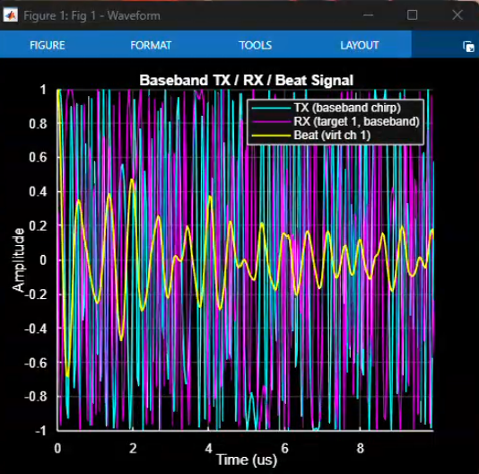
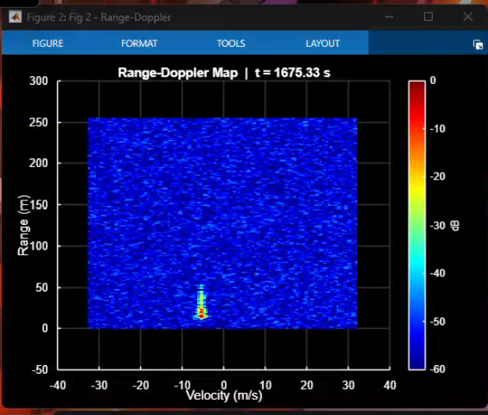
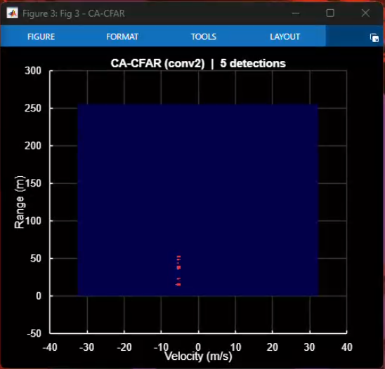
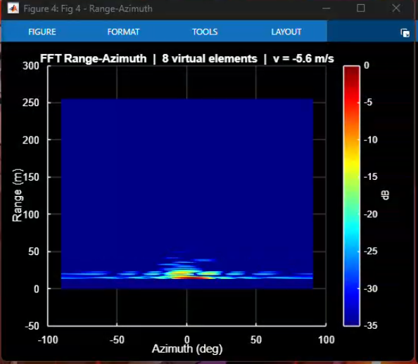
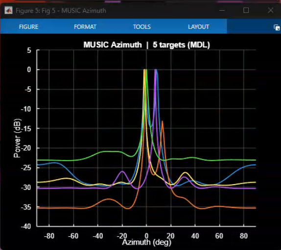
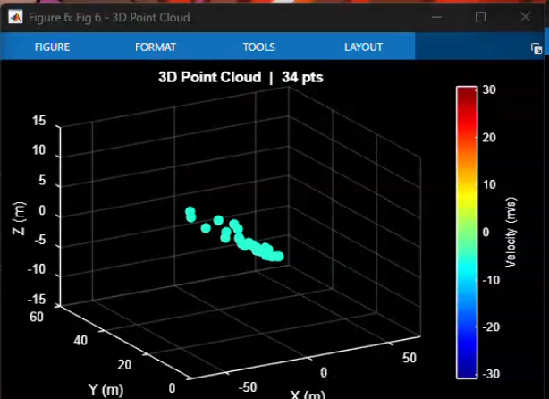
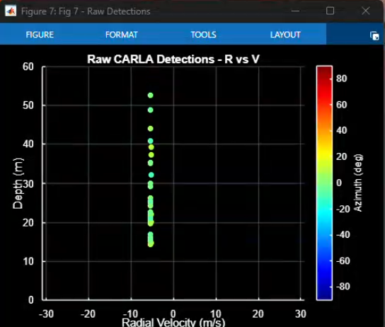
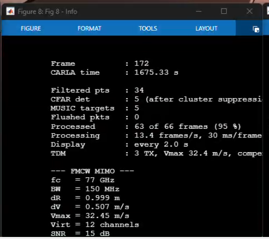
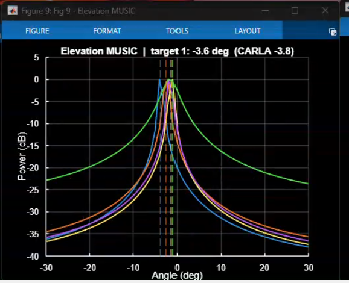
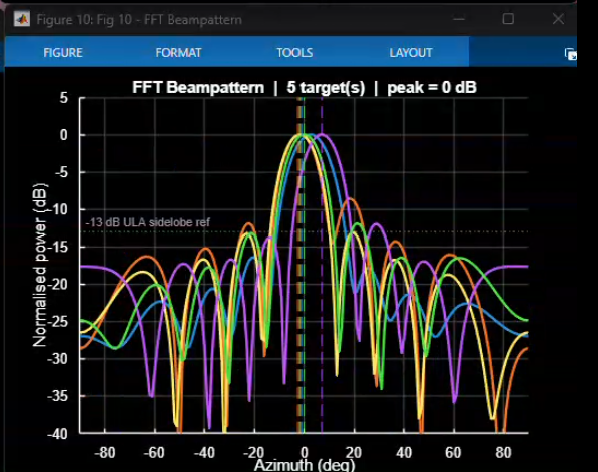

# v3 figures

The ten MATLAB windows of one v3 frame (CARLA time 1675.33 s, city drive, 3 TX TDM, 12 virtual channels).

| | |
|---|---|
|  **Fig 1** Baseband TX chirp, RX echo and beat signal |  **Fig 2** Range-Doppler map: roadside objects at the ego speed (−5.6 m/s) |
|  **Fig 3** CA-CFAR detections (5 after cluster suppression) |  **Fig 4** FFT range-azimuth map, 8-element virtual array |
|  **Fig 5** MUSIC azimuth spectrum, one curve per target |  **Fig 6** 3-D point cloud of the filtered CARLA detections |
|  **Fig 7** Raw CARLA detections, depth vs. radial velocity |  **Fig 8** Info panel: 95 % of frames processed, 30 ms per frame |
|  **Fig 9** Elevation MUSIC: −3.6° estimated, CARLA −3.8° |  **Fig 10** CBF beampattern; dashed lines = CARLA azimuth |
